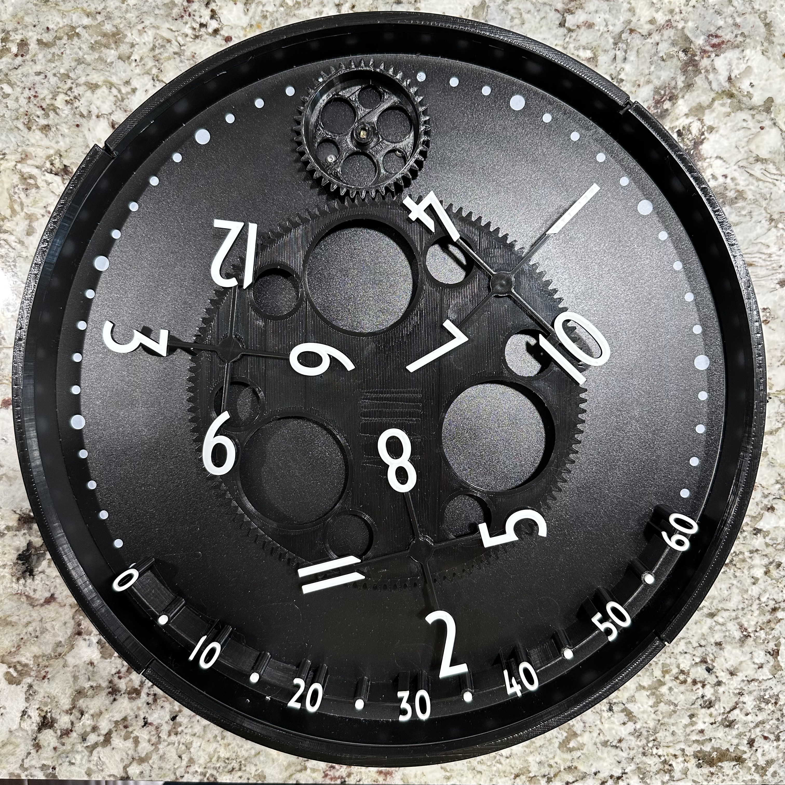
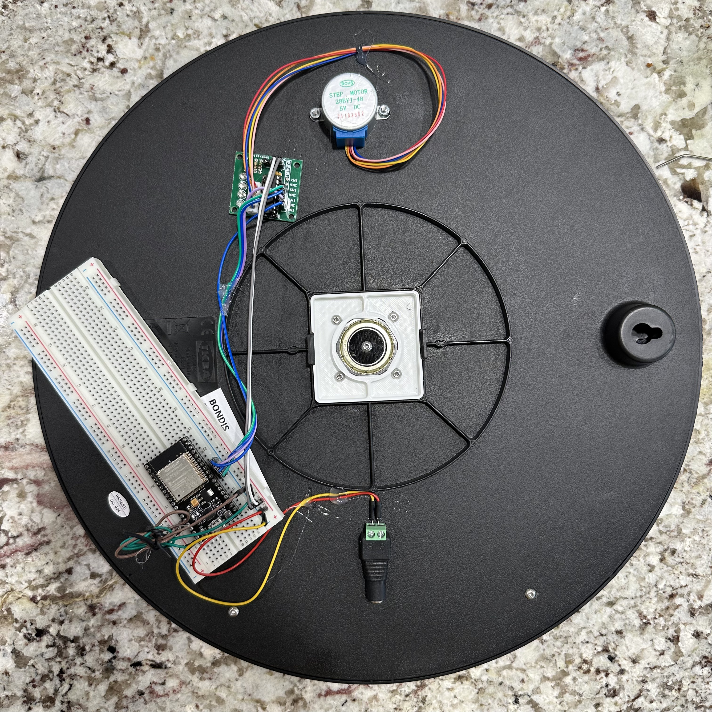
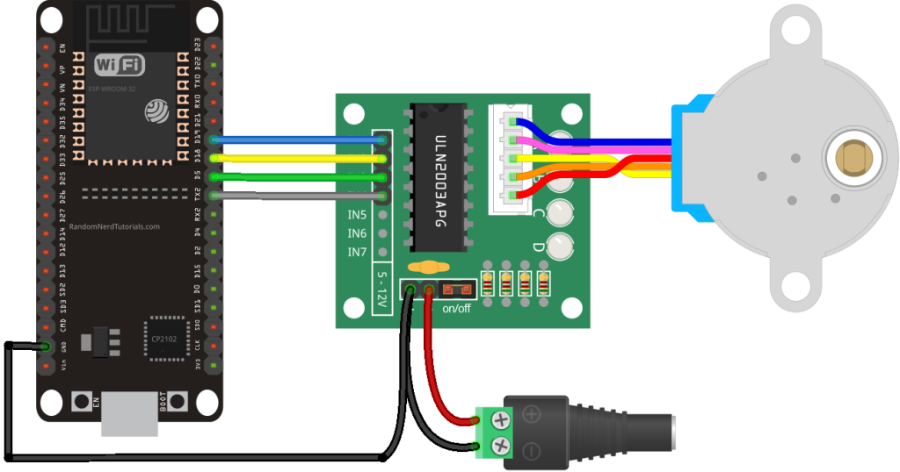
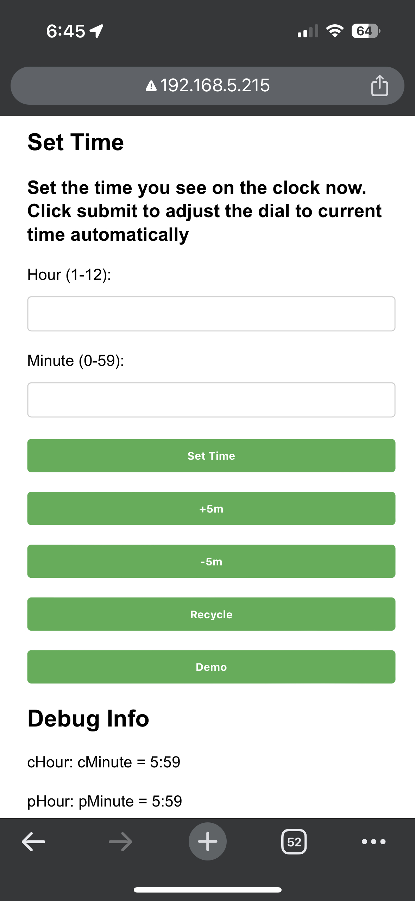
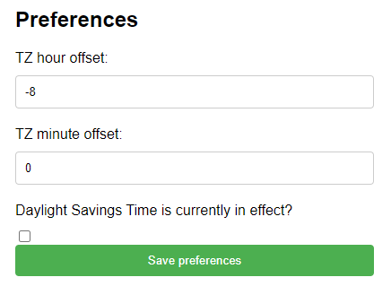

# Wandering Hour Clock

A WiFi-connected wandering hour clock powered by an ESP32 and a stepper motor. It syncs time via NTP and includes a web interface for calibration and timezone configuration.

Based on the 3D-printed [Improved Wandering Hour Clock](https://www.printables.com/model/327198-improved-wandering-hour-clock) design.

<p align="center">
  
</p>

<sub>GIF credit: [Printables](https://www.printables.com/model/327198-improved-wandering-hour-clock)</sub>

---

## How It Works

A wandering hour clock tells time differently from a traditional clock. Instead of fixed hands rotating around a central point, the **hour numerals themselves orbit** around the clock face. The current hour numeral aligns with a minute track along the outer ring, indicating the precise time. As each hour passes, the next numeral rotates into position.

This build replaces the original quartz clock movement with an ESP32-driven stepper motor. The ESP32 connects to WiFi, syncs to an NTP time server, and precisely drives the mechanism — no manual time-setting needed after initial setup.

---

## Photos

<p align="center">
  &nbsp;&nbsp;
  
</p>

---

## Features

- **Automatic NTP time sync** — accurate time without manual adjustment
- **Web UI** — set time, adjust the dial, run motor diagnostics, and configure timezone preferences from any browser on the local network
- **Timezone and DST support** — saved to non-volatile storage and persists across power cycles
- **OTA firmware updates** — upload new firmware wirelessly via Arduino IDE
- **Resilient to network outages** — continues running if WiFi or NTP is unavailable, reconnects automatically
- **Home Assistant integration** — MQTT auto-discovery exposes clock sensors and control buttons directly in HA

---

## Hardware

### Parts List

| Component | Notes |
|---|---|
| [Ikea BONDIS clock](https://www.ikea.com/) | Used as the clock body/housing |
| 3D-printed parts | From [Printables #327198](https://www.printables.com/model/327198-improved-wandering-hour-clock), **except** ClockMovementGear and Standoffs |
| ClockMovementGear | From [Printables #429804](https://www.printables.com/model/429804-wandering-hour-clock-with-stepper-motor) |
| Standoffs | From [Printables #476980](https://www.printables.com/model/476980-wandering-hour-clock-w-arduino-wifi-stepper-motor-) |
| ESP32 dev board | Any ESP32 board with WiFi (ESP8266 also works) |
| 28BYJ-48 stepper motor | Unipolar, 2048 steps/revolution |
| ULN2003 motor driver board | Typically sold bundled with the 28BYJ-48 |
| 5V power supply | 2A+ recommended |
| Jumper wires | For connecting ESP32 to ULN2003 |

### Wiring

Connect the ESP32 to the ULN2003 driver board as follows:

| ESP32 Pin | ULN2003 Pin |
|---|---|
| GPIO 19 | IN1 |
| GPIO 18 | IN2 |
| GPIO 5 | IN3 |
| GPIO 17 | IN4 |

The ULN2003 board powers the stepper motor — connect its 5-12V input to your 5V supply.

<p align="center">
  
</p>

<sub>Wiring diagram credit: [RandomNerdTutorials.com](https://randomnerdtutorials.com). Full tutorials for [ESP32](https://randomnerdtutorials.com/esp32-stepper-motor-28byj-48-uln2003/) and [ESP8266](https://randomnerdtutorials.com/esp8266-nodemcu-stepper-motor-28byj-48-uln2003/).</sub>

---

## Software Setup

### Prerequisites

1. Install [Arduino IDE](https://www.arduino.cc/en/software)
2. Add ESP32 board support: **Preferences > Additional Board Manager URLs** and add:
   ```
   https://raw.githubusercontent.com/espressif/arduino-esp32/gh-pages/package_esp32_index.json
   ```
3. Install the **Time** library by Paul Stoffregen via **Library Manager**
4. Install the **PubSubClient** library by Nick O'Leary via **Library Manager** (MQTT client)
5. Create a `secrets.h` file in the project directory:
   ```cpp
   #define SECRET_SSID "your_wifi_network_name"
   #define SECRET_PASSWORD "your_wifi_password"

   // MQTT broker (required for Home Assistant integration)
   #define MQTT_SERVER "192.168.1.x"  // your broker IP or hostname
   #define MQTT_PORT   1883
   #define MQTT_USER   "your_mqtt_user"
   #define MQTT_PASSWORD "your_mqtt_password"
   ```
   This file is gitignored and must be created locally.

### Compile and Upload

1. Open `wandering-hour-clock.ino` in Arduino IDE
2. Select board: **ESP32 Dev Module** (or your variant)
3. Select the correct serial port
4. Click **Upload**

Or via command line:

```bash
arduino-cli compile --fqbn esp32:esp32:esp32 wandering-hour-clock/
arduino-cli upload --fqbn esp32:esp32:esp32 --port /dev/cu.usbserial-0001 wandering-hour-clock/
```

### OTA (Over-the-Air) Updates

After the initial USB flash, subsequent firmware updates can be uploaded wirelessly. In Arduino IDE, the clock will appear as a network port under **Tools > Port**.

### Serial Monitor

Set baud rate to **115200** for debug output (WiFi status, NTP sync, step counts).

---

## Web Interface

Once connected to WiFi, the clock hosts a web server accessible at:

- `http://wandering-hour-clock.local/` (via mDNS)
- Or the device's IP address (printed to Serial on boot)

### Controls

<p align="center">
  
</p>

| Control | Description |
|---|---|
| **Set Time** | Enter the time currently shown on the clock face. The motor will automatically adjust to match NTP time. |
| **+5m / -5m** | Nudge the dial forward or backward by 5 minutes |
| **Recycle** | Run a full counter-clockwise then clockwise rotation (motor test / reset) |
| **Demo** | Advance through 12 full hours to showcase the wandering hour mechanism |

The **Debug Info** section at the bottom shows internal state (`cHour:cMinute` and `pHour:pMinute`) for troubleshooting.

### Timezone Preferences

<p align="center">
  
</p>

1. Look up your [UTC offset](https://en.wikipedia.org/wiki/List_of_UTC_offsets)
2. Enter the **hour offset** and **minute offset** (for half/quarter-hour timezones)
3. Check the **DST** box if daylight saving time is currently in effect
4. Click **Save preferences**

**Example:** Newfoundland (UTC-3:30) during summer — hour offset: `-3`, minute offset: `30`, DST: checked.

Preferences are stored in non-volatile memory and persist across power cycles. After changing the timezone, use **Set Time** to resynchronize the dial.

---

## Home Assistant Integration

The firmware uses MQTT with [Home Assistant auto-discovery](https://www.home-assistant.io/integrations/mqtt/#mqtt-discovery). Once the clock connects to your MQTT broker, it automatically registers itself as a device in HA — no manual YAML configuration needed.

### Prerequisites

- A running MQTT broker (e.g. [Mosquitto](https://mosquitto.org/)) reachable from the ESP32
- The MQTT integration enabled in Home Assistant
- MQTT credentials set in `secrets.h` (see Software Setup above)

### Entities Created

| Entity | Type | Description |
|---|---|---|
| Clock Time | Sensor | Current time displayed on the clock face (e.g. `3:45`) |
| WiFi Signal | Sensor | ESP32 RSSI in dBm |
| Forward 5m | Button | Advance the dial by 5 minutes |
| Backward 5m | Button | Rewind the dial by 5 minutes |
| Recycle | Button | Full CCW then CW rotation (motor reset) |
| Demo | Button | Advance through 12 full hours |

### MQTT Topics

| Topic | Direction | Description |
|---|---|---|
| `wandering-hour-clock/command` | HA → clock | Send a command (see below) |
| `wandering-hour-clock/state` | clock → HA | JSON state payload, published every 60s and after every command |
| `wandering-hour-clock/availability` | clock → HA | `online` / `offline` (LWT) |

### State Payload

```json
{"time":"3:45","hour":3,"minute":45,"rssi":-62,"ip":"192.168.1.42"}
```

### Commands

Publish any of the following to `wandering-hour-clock/command`:

| Payload | Effect |
|---|---|
| `forward-5` | Advance dial 5 minutes |
| `backward-5` | Rewind dial 5 minutes |
| `recycle` | Run recycle cycle |
| `demo` | Run 12-hour demo |
| `set:H:MM` | Adjust dial to a specific time (e.g. `set:3:45`) |

---

## How the Motor Math Works

The 28BYJ-48 stepper motor takes **2048 steps per revolution**, which maps to one full hour on the clock face.

- Each minute: `2048 / 60 = 34 steps` (integer division)
- Lost steps per hour: `2048 - (34 x 60) = 8 steps`
- The firmware compensates by adding the 8 missing steps at each hour boundary

---

## License

[GPLv3](LICENSE)
